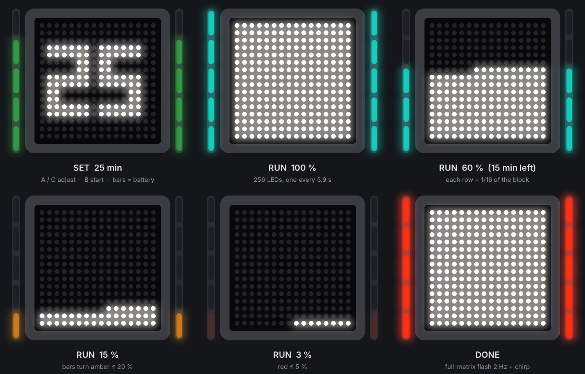

# Matrix-Timer
A virtual hour glass with different length options, representing time left in work blocks: 256 LEDs tick off row by row.

Runs on an **M5Stack CoreMatrix** (ESP32-C61, 16×16 LED matrix) stacked on an **M5GO Bottom2** (battery + LED bars).

- [docs/design.md](docs/design.md): app design (grid face, states, buttons, timing model, firmware architecture)
- [docs/hardware.md](docs/hardware.md): hardware deep-dive (pins, buses, power, how the two boards interconnect, toolchain, bench checks)
- [tools/mockups/render.py](tools/mockups/render.py): renders the mockups; reference implementation of the rendering model
