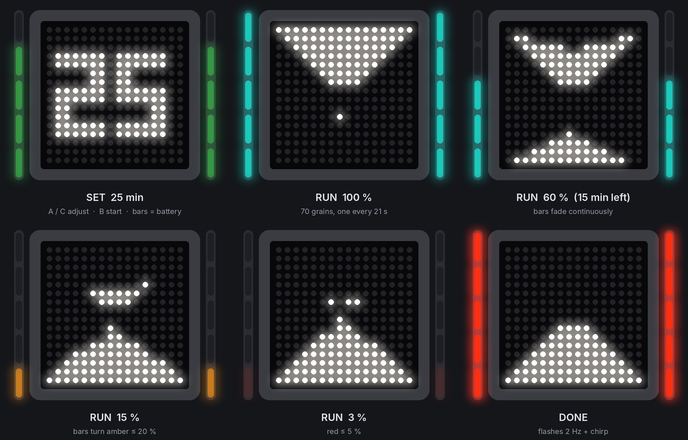
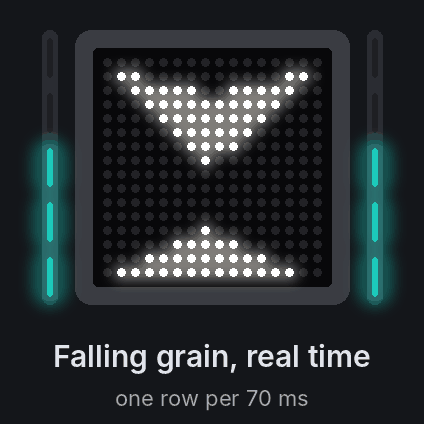
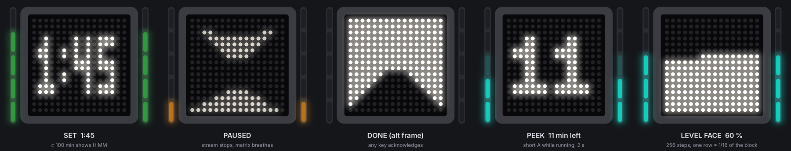
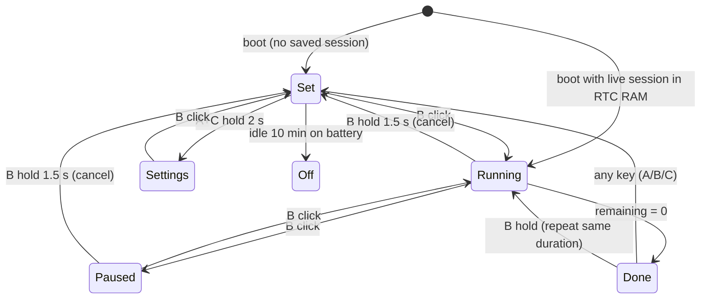
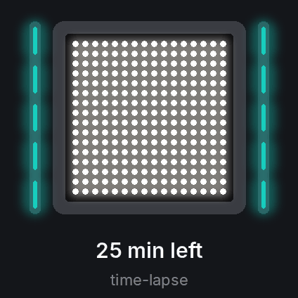
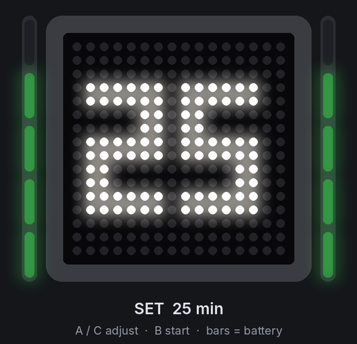
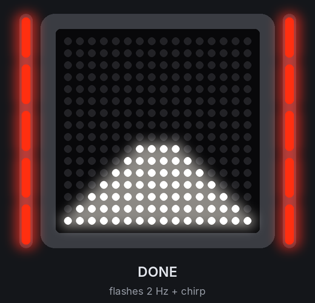
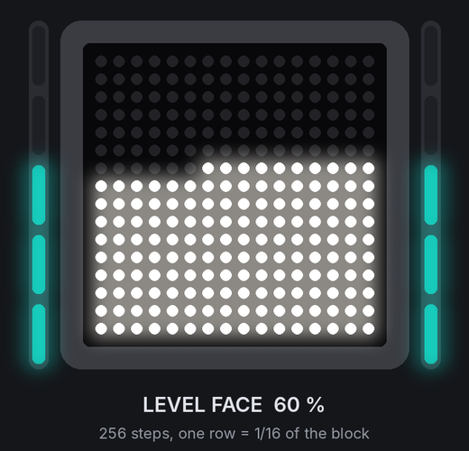

# Design: the hourglass work timer

Companion to [hardware.md](hardware.md), which this doc relies on for every pin, part and library call. Mockups are rendered by [`tools/mockups/render.py`](../tools/mockups/render.py), which is also the reference implementation of the rendering model; port it, don't reinvent it.



## 1. What it is

A desk hourglass for work blocks. You set a duration, press start, and sand drains from the top chamber of a 16×16 LED hourglass into the bottom. The pixels left in the top chamber *are* the time remaining. The LED bars on the Bottom2 flanking the matrix show the same quantity as a smooth analogue gauge and shift colour as the block ends. When the top is empty it flashes and chirps.

**Goals:** glanceable remaining time from across a desk; a sense of continuous motion; durations from 1 minute to 4 hours set in seconds with three buttons; a full workday on battery; survive an accidental reset without losing the block.

**Non-goals for v1:** networking, phone/Mac app, Pomodoro break sequencing, microphone, microSD, calendar sync. §10 lists them as follow-ups.

## 2. Constraints from the hardware

These decide the design more than taste does (details in hardware.md §1):

- **Matrix pixels are 1-bit white.** "Continuous" can't come from dimming individual pixels. It comes from motion (a falling grain) and from the bars, which have 8-bit RGB per LED.
- **Bars need our own SPI driver** (no RMT on the C61) and exist only while the PM1 5 V boost is on.
- **The IMU may be unusable** if the Bottom2's IMU collides with the Core Matrix's at 0x68. Nothing essential may depend on it.
- **The power button resets by default.** Either embrace it or disable it; this design disables single-click reset and also persists state so a reset is harmless anyway.

## 3. Faces

### 3.1 Hourglass (default)

Geometry on the 16×16 grid, row 0 at the top (after rotation):

| Region | Rows | Columns | Cells |
|---|---|---|---|
| Top chamber | 0–6 | row *r* spans *r* … 15−*r* (16, 14, …, 4 wide) | **70** |
| Neck | 7–8 | 7–8 | stream channel only |
| Bottom chamber | 9–15 | row *r* spans 15−*r* … *r* (4, 6, …, 16 wide) | **70** |

So a block is **70 grains**. Grains left = `ceil(70 × remaining / total)`. Using ceil means *a lit grain in the top always means time remains*, and the last grain leaves at exactly zero.

- **Draining order** (top): sort cells by `row + 0.25·|col − 7.5|`. The surface falls row by row with a shallow funnel at the centre, the way sand actually leaves a chamber.
- **Filling order** (bottom): sort by `(15 − row) + 0.5·|col − 7.5|`. A mound grows from the centre of the floor.
- **Falling grain:** while running, one pixel drops from the neck to the top of the pile, one row per 70 ms, alternating columns 7 and 8, with a two-frame pause at the neck. It is decoration: it says "running" and supplies motion between grain transfers, which come every `total/70` (21 s for 25 minutes, 51 s for an hour).



**Position taken:** a literal hourglass over a fill bar. 70 steps is coarse, but the metaphor is the product, and the bars carry the precision. No glass outline: on a monochrome matrix an always-lit outline is indistinguishable from sand and wastes ~40 pixels.

### 3.2 Level (alternative)

All 256 pixels lit at start, draining row by row from the top, left to right. 256 steps; each row is exactly 1/16 of the block, which makes it the more *readable* face ("a bit over half a row per ten minutes"). Same engine, different order table. Selectable in settings (§5.3).



### 3.3 Digits

Used for setting and peeking, never as the running face.

- Under 100 minutes: minutes in a 3×5 font drawn at **2×** (6×10 glyphs, "25" is 14 px wide).
- 100 minutes and over: **H:MM** in the 3×5 font at 1× wide, 2× tall ("1:45" is 13 px wide).
- Under one minute (peek only): seconds, same 2× font.

## 4. The LED bars

The Bottom2's ten SK6812s are treated as two 5-LED columns, index 0 at the bottom, drawn identically on both sides. The physical chain order is mapped once at bring-up (hardware.md §9 check 4).

| State | Bars |
|---|---|
| Set | Battery level, dim green; animate upward while charging |
| Running | **Remaining-time gauge.** Each LED is 20 % of the block; the topmost lit LED's brightness carries the remainder, so the bar shrinks continuously. Teal above 20 %, amber ≤ 20 %, red ≤ 5 %. The bottom LED never fades below 15 % while time remains. |
| Paused | Bottom LED amber, steady, dim |
| Done | Red, pulsing with the matrix flash |
| Low battery (< 15 %) | Bottom-left LED blinks red once every 5 s, in any state |

Brightness cap 25 % of full scale with gamma 2.2: SK6812s at full power are glaring on a desk and cost ~12 mA per channel. Colour shifts cross-fade over 2 s rather than snapping.

**Position taken:** gauge on both bars, not "left = elapsed, right = remaining". Mirrored bars read as one instrument from any angle; split semantics need a legend.

## 5. Interaction

### 5.1 State machine



### 5.2 Buttons

KEY1/2/3 are A/B/C in physical left-to-right order (to be confirmed on the bench). B is always the primary action.

| State | A (left) | B (middle) | C (right) | Power |
|---|---|---|---|---|
| **Set** | −step (hold: repeat, accelerating) | **Start** | +step (hold: repeat) | click: matrix on/off · double: power off |
| **Running** | **Peek**: remaining as digits for 2 s | **Pause** · hold 1.5 s: cancel | hold 1 s: **+5 min** | same |
| **Paused** | Peek | **Resume** · hold: cancel | +5 min | same |
| **Done** | Dismiss | Dismiss · hold: **repeat** | Dismiss | same |

**Duration steps** (A/C in Set): 1 min steps up to 10, 5 min to 60, 15 min to 240, wrapping 240 → 1. Holding repeats at 4 Hz, rising to 10 Hz after a second. The last-used duration is stored in NVS and preselected at boot. Starting at 25 min means the common case is a single B press.

**Peek over always-on digits:** the hourglass is the point; digits on demand cover the "exactly how long?" moment.

**Cancel needs a hold** so a fumbled pause never discards a block. Cancel shows the hourglass draining all its remaining sand quickly (300 ms) as confirmation.

### 5.3 Settings

Entered with A+C held for 2 s from Set; the matrix shows a one-letter code per item, A/C change the value, B advances, B on the last item exits.

| Item | Values | Default |
|---|---|---|
| Face | Hourglass, Level | Hourglass |
| Matrix brightness | 1–8 (TM1680 duty 1/16–8/16) | 3 |
| Bars | On, Off (boost off on battery, saves ~15 mA) | On |
| Sound | Chirp, Silent | Chirp |
| Orientation | Auto (IMU, only if check passes), 0°, 90°, 180°, 270° | Auto, else 0° |

### 5.4 Tilt (optional, gated on the IMU check)

If the boot-time IMU check passes (hardware.md §9 check 3):

- **Auto-orientation:** the frame rotates in 90° steps so sand always falls toward gravity, with 1 s of hysteresis.
- **Flip to repeat:** in Done, turning the device over (sustained 180° change, > 0.8 s) restarts the same duration, as you'd flip a real hourglass.
- **Face-down to pause:** matrix toward the desk for > 2 s pauses; turning it back resumes.

If the check fails, none of this exists and the orientation setting is manual. No feature is lost that the buttons can't do.

### 5.5 Done

Matrix alternates normal and inverted at 2 Hz; bars pulse red. Buzzer (IOE1 PWM at ~2.7 kHz, the MLT-8530's resonance) plays three short chirps, repeating every 10 s for 1 minute, then stops; the visual alarm continues at 0.5 Hz until dismissed. **Position taken:** no continuous beeping. This sits next to someone working.

## 6. Timing model

Time is computed, never counted:

```
remaining = duration − (now − started_at − paused_total)        // all in µs
now = esp_timer_get_time()
```

Rendering and the gauge are pure functions of `remaining / duration`, so a skipped frame, a slow I2C transaction or a light-sleep overshoot can't accumulate error. The firmware only *schedules* wakeups; it never decrements a counter.

**Persistence across resets.** Every grain transfer and every state change writes a 16-byte record to the PM1's RTC RAM (hardware.md §2.4): magic, state, duration_s, remaining_ms, face, CRC8. It survives ESP resets and ESP power-off, not PM1 power loss. On boot, a valid Running record resumes with `remaining` as saved (losing at most one grain's interval, e.g. 21 s of a 25-minute block, during which the device was resetting anyway); a Paused record resumes paused; a Done record shows Done. Monotonic time does not survive a reset, so the record stores *remaining*, not a timestamp.

**Power-button single click** is set to *not* reset (`SINGLE_RESET_DIS`) at boot and is used as matrix on/off. Double-click power-off and long-press download mode stay as the PM1 provides them, so a hung firmware is always recoverable without tools.

## 7. Firmware architecture

Arduino on arduino-cli, M5Unified + M5GFX, one loop, no RTOS tasks of our own.

| Module | Responsibility | Notes |
|---|---|---|
| `Clock` | `remaining()`, start/pause/resume/cancel/extend | Pure; unit-testable on the host |
| `Faces` | Order tables (`TOP_DRAIN`, `BOTTOM_FILL`, `LEVEL_DRAIN`), `frame(face, fraction, anim_t) → uint16_t[16]` | Port of `render.py`; tables are `constexpr` |
| `Matrix` | 1-bit canvas → TM1680; push only if the 32-byte frame changed; global brightness | Draw into a 16-row `uint16_t` bitmap, push once via `startWrite()/endWrite()` (hardware.md §2.2) |
| `Bars` | Logical gauge → 10 RGB → SK6812 over SPI2 on G5; gamma, cap, cross-fade | hardware.md §6; owns `bar_index` mapping |
| `Input` | `M5.update()`; clicks, holds, chords; PWR button; tilt events if enabled | Debounced by M5Unified |
| `Persist` | RTC RAM session record (M5PM1 lib); NVS for settings and last duration | |
| `Power` | Battery %, charging, LVP 3.3 V, idle auto-off, boost off when bars disabled | |
| `Sound` | Buzzer chirps via IOE1 PWM channel | |
| `App` | State machine of §5.1 | |

**Frame scheduling.** While running, render at the falling-grain cadence (70 ms); in every other state, render on events plus 50 ms ticks for animations (breathing, flash). Matrix pushes only on change: the grain animation changes one or two pixels per frame, so ~14 pushes/s × 0.8 ms ≈ 1 % bus occupancy. Bars update at 20 Hz for smooth fades (120-byte SPI burst each, negligible).

**Sleep.** On battery, enable automatic light sleep between frames and wake on the PM1 IRQ (G2) for buttons. On USB, stay awake. In Set, on battery, after 10 minutes without input → PM1 power-off; a click on power brings it back to Set with the last duration.

**Bring-up order** (each step a commit, each runnable): blink a pixel → hourglass static frames from the tables → `Clock` with peek digits → buttons and state machine → persistence → bars → sound → power/sleep → tilt.

## 8. Mockup reference



| | |
|---|---|
|  |  |
|  |  |
|  |  |
|  |  |
|  |  |

The bars are drawn flanking the matrix as they appear with the stack standing upright; their real position is on the Bottom2's side faces, behind the matrix plane. Matrix brightness in the images is idealised; the real panel at 3/16 duty is dimmer and the "off" pixels are invisible.

## 9. Open questions

1. **Upright or flat?** The hourglass reads best standing up like a picture frame. Standing on which edge depends on where the USB-C port and buttons are (bench check 5). If it lies flat, auto-orientation (IMU permitting) or a fixed setting handles "down". *Recommendation: upright, on a small stand, cable out the side.*
2. **Which Bottom2 revision?** Decides whether tilt features can exist at all (hardware.md §5.4).
3. **70 grains enough?** For blocks over ~90 minutes a grain moves less than once a minute. The bars cover it, but if it feels static, the Level face (256 steps) is one setting away. A taller hourglass using the full width at rows 0–1 and 14–15 could reach ~86 grains, at the cost of a less recognisable silhouette.
4. **Pomodoro sequencing** (work → 5 min break → work) is a small extension of the state machine; worth doing only if you'd use it.
5. **Companion app.** Not in v1. If wanted later, the cheapest path is a BLE GATT service (duration, start/stop, state notifications) driven from a Mac menu-bar app or a Web Bluetooth page; the C61 supports BLE 5.

## 10. Follow-ups (not v1)

Pomodoro cycles; BLE companion; daily block log to NVS with a "blocks completed today" view; multiple saved presets on long-press A/C; Wi-Fi time sync for a clock face between blocks.
