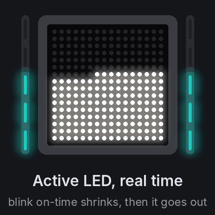
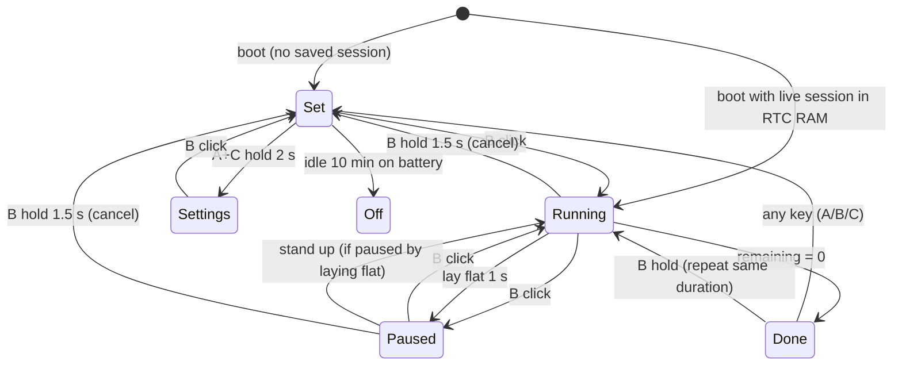
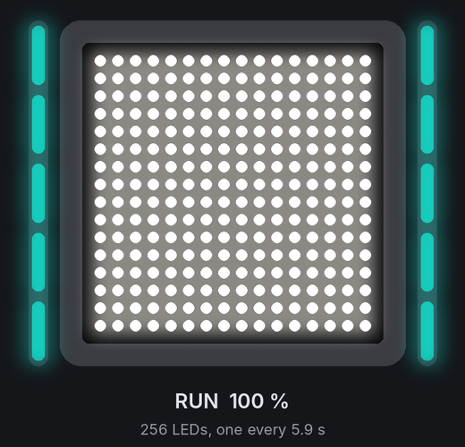
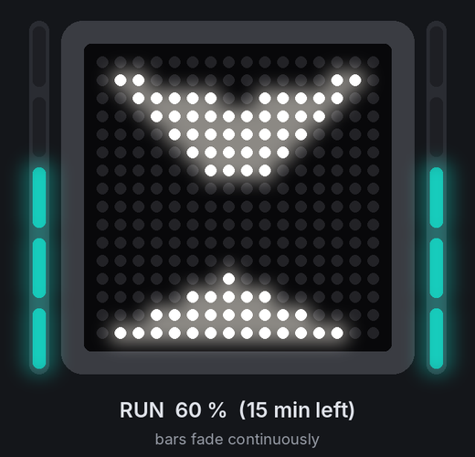
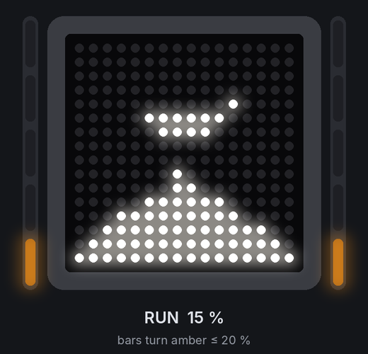
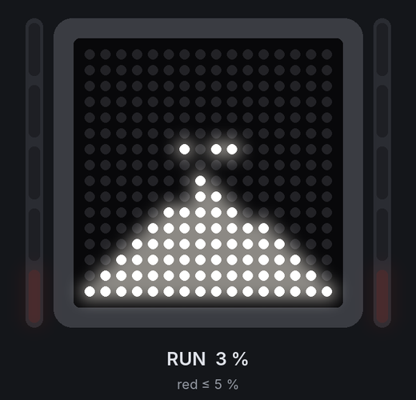
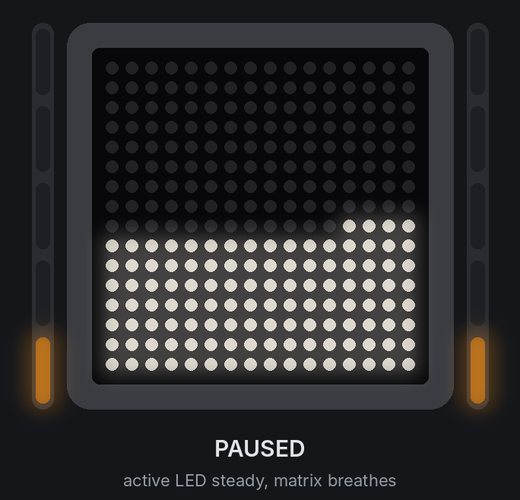
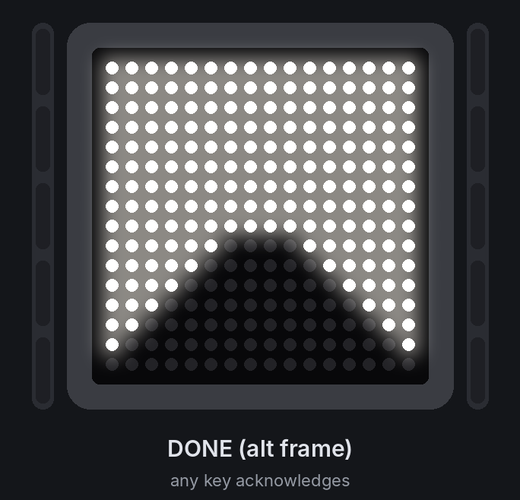
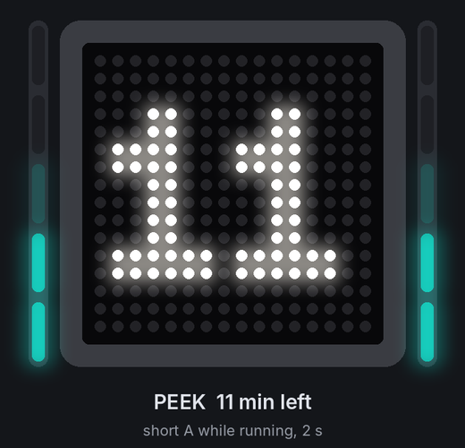
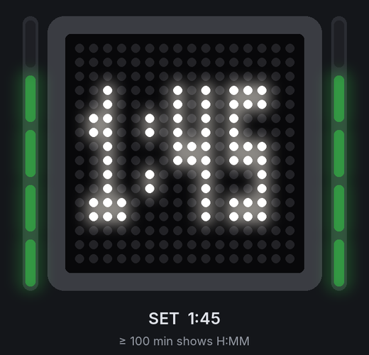

# Design: the row-by-row work timer

Companion to [hardware.md](hardware.md), which this doc relies on for every pin, part and library call. Mockups are rendered by [`tools/mockups/render.py`](../tools/mockups/render.py), which is also the reference implementation of the rendering model; port it, don't reinvent it.


## 1. What it is

A utilitarian desk timer for work blocks: a digital hourglass without the hourglass styling. You set a duration and press start. All 256 LEDs light, then tick off one at a time, left to right along the top row, then along the next row down, until the last LED in the bottom-right corner goes out. The LEDs still lit *are* the time remaining. The LED that is currently being used up blinks, so the display is visibly moving between ticks. The LED bars on the Bottom2 show the same quantity as a smooth analogue gauge and shift colour as the block ends. When the last LED goes out, the matrix flashes and chirps.

**Goals:** glanceable remaining time from across a desk; a sense of continuous motion; durations from 1 minute to 4 hours set in seconds with three buttons; a full workday on battery; survive an accidental reset without losing the block.

**Non-goals for v1:** networking, phone/Mac app, Pomodoro break sequencing, microphone, microSD, calendar sync. §10 lists them as follow-ups.

## 2. Constraints from the hardware

These decide the design more than taste does (details in hardware.md §1):

- **Matrix pixels are 1-bit white.** "Continuous" can't come from dimming individual pixels. It comes from timing (the active LED's blink duty, §3.1) and from the bars, which have 8-bit RGB per LED.
- **Bars need our own SPI driver** (no RMT on the C61) and exist only while the PM1 5 V boost is on.
- **Two IMUs share 0x68 whenever the 5 V boost is on** (the Bottom2's MPU6886 and the Core Matrix's BMI270). A bench-verified register trick makes the BMI270's accelerometer readable anyway (hardware.md §5.4), but it is a trick: nothing essential may depend on the IMU.
- **The power button resets by default.** Either embrace it or disable it; this design disables single-click reset and also persists state so a reset is harmless anyway.

## 3. The display

### 3.1 The grid (the running face)

| Property | Value |
|---|---|
| Ticks per block | **256** (every LED) |
| Order | Row 0 left → right, then row 1, … row 15. Row 0 is the top after rotation. |
| LEDs lit | `ceil(256 × remaining / total)` |
| One LED | `total / 256`: 5.9 s for 25 min (about 4 blinks), 14 s for 1 h, 56 s for 4 h |
| One row | exactly 1/16 of the block: 94 s for 25 min, 3¾ min for 1 h |

Using ceil means *a lit LED always means time remains*, and the last LED goes out at exactly zero. Reading it is arithmetic you can do at a glance: rows left ÷ 16 is the fraction left, and for a 1-hour block each row is 3¾ minutes.

**The active LED.** The first lit LED is the one being consumed. It blinks **1 s on, 0.5 s off** in an unbroken rhythm. The display moves on to the next LED (or the next row) only at the start of a blink cycle. In the off phase just before that, the outgoing LED and the next one go dark together, and the next one then blinks back on, on schedule, so a hand-over looks like one ordinary blink. The price is that an LED can go out up to one cycle (1.5 s) after its exact time. That is invisible at 5.9 s per LED, and Done still fires at the exact time. This was tuned on the desk with Steel on 21 Nov. The original design shrank the on-time within a 1 s cycle, so the LED "drained", but it ended in a flicker and jumped at hand-overs. If a slice is under 1.5 s (blocks under ~6.4 minutes), the active LED stays steady; at that pace the ticking itself is the motion.

**Paused:** the active LED holds steady and the whole matrix drops to a static 1/16 duty, its dimmest step, while the bars show a dim amber LED at the bottom (§4). Steel tried the original breathing version on the desk (21 Nov) and preferred a static dim. It still reads as "paused" from across a room without a glyph over the grid.



**Position taken:** left-to-right on every row, not a serpentine. Serpentine is smoother when you watch it, but left-to-right reads like text, and the "how many rows left" count stays easy.

### 3.2 Digits

Used for setting and peeking, never as the running face.

- Under 100 minutes: minutes in a 3×5 font drawn at **2×** (6×10 glyphs, "25" is 14 px wide).
- 100 minutes and over: **H:MM** in the 3×5 font at 1× wide, 2× tall ("1:45" is 13 px wide).
- Under one minute (peek only): seconds, same 2× font.

## 4. The LED bars

The Bottom2's ten SK6812s are treated as two 5-LED columns, position 0 at the bottom, drawn identically on both sides. The physical chain is a U (hardware.md §5.3); `Bars` maps logical positions to chain indices from the current rotation, so the gauge fills from whichever edge stands down. The bars need the 5 V boost on USB as well as on battery.

| State | Bars |
|---|---|
| Set | Battery level, dim green (USB power only under Auto); animate upward while charging |
| Running | **Remaining-time gauge.** Each LED is 20 % of the block; the topmost lit LED's brightness carries the remainder, so the bar shrinks continuously. The LEDs above the bottom one are drawn one step lower than this, because light bleeding through the diffuser made the bar look a LED fuller than meant (desk check, 21 Nov). A fresh block still starts with all five lit; the top one fades out after 15 s. Teal above 20 %, amber ≤ 20 %, red ≤ 5 %. The bottom LED never fades below 15 % while time remains. |
| Paused | Bottom LED amber, steady, dim |
| Done | Red, pulsing with the matrix flash |
| Low battery (< 15 %) | Bottom-left LED blinks red once every 5 s, in any state |

**Power, and why the bars are off on battery by default.** An SK6812 at full white draws ~36 mA (≈12 mA per colour) and is glaring on a desk, so brightness is capped at **10 %** of full scale with gamma 2.2; through the Bottom2's diffuser that is still clearly visible indoors (to confirm on the bench). Even capped, a full teal gauge is ~17 mA at 5 V, ~25 mA from the cell after the boost, ~12 mA averaged over a block as it shrinks. The bigger, less obvious cost is the 5 V rail itself: the ten SK6812s idle at ~5–10 mA *while dark*, plus boost losses, for as long as the rail is on. Together the bars can double the device's consumption, so the default is **Auto: gauge on USB power, bars and their 5 V rail off on battery** (hardware.md §8). Turning the rail off also unpowers the Bottom2's IMU, which removes the 0x68 collision outright, so on battery the Core Matrix's IMU is read with no workaround at all.

Colour shifts cross-fade over 2 s rather than snapping.

**Position taken:** gauge on both bars, not "left = elapsed, right = remaining". Mirrored bars read as one instrument from any angle; split semantics need a legend.

## 5. Interaction

### 5.1 State machine



### 5.2 Buttons

KEY1/2/3 are A/B/C in order along the button edge (confirmed on the bench). B is always the primary action. One B press registered twice on the bench, so `Input` adds its own 50 ms lockout per button on top of M5Unified's debounce.

| State | A (left) | B (middle) | C (right) | Power |
|---|---|---|---|---|
| **Set** | −step (hold: repeat, accelerating) | **Start** | +step (hold: repeat) | click: matrix on/off · double: power off |
| **Running** | **Peek**: remaining as digits for 2 s | **Pause** · hold 1.5 s: cancel | hold 1 s: **+5 min** | same |
| **Paused** | Peek | **Resume** · hold: cancel | +5 min | same |
| **Done** | Dismiss | Dismiss · hold: **repeat** | Dismiss | same |

**Duration steps** (A/C in Set): 1 min steps up to 10, 5 min to 60, 15 min to 240, wrapping 240 → 1. Holding repeats at 4 Hz, rising to 10 Hz after a second. The last-used duration is stored in NVS and preselected at boot. Starting at 25 min means the common case is a single B press.

**Peek over always-on digits:** the grid is the point; digits on demand cover the "exactly how long?" moment.

**Cancel needs a hold** so a fumbled pause never discards a block. Cancel confirms by wiping the remaining LEDs off in 300 ms.

### 5.3 Settings

Entered with A+C held for 2 s from Set; the matrix shows a one-letter code per item, A/C change the value, B advances, B on the last item exits.

| Item | Values | Default |
|---|---|---|
| Matrix brightness | 1–8 (TM1680 duty 1/16–8/16) on USB; on battery capped at 2/16 | 4 (desk check, 21 Nov) |
| Bars | Auto (on with USB, off on battery), On, Off | Auto |
| Bar brightness | 5, 10, 25 % of full | 10 % |
| Sound | Chirp, Silent | Chirp |
| Orientation | Auto (IMU), 0°, 90°, 180°, 270° | Auto, else 0° (up = button edge) |

### 5.4 Lay flat to pause

The device stands like a picture frame. **Laying it down flat pauses the block; standing it back up resumes.** This is the primary pause gesture; B still works.

Detection is plain gravity, no motion learning needed. Standing, gravity lies in the plane of the matrix; lying flat, it points through the matrix (the BMI270's Z axis). Rule: Z carries > 0.8 g for 1 s → pause; in-plane gravity > 0.8 g for 0.5 s → resume. The 1 s dwell ignores the device being picked up or nudged. The same in-plane vector says which edge is down, so the frame auto-rotates in 90° steps to keep row 0 at the top (1 s hysteresis), and the buttons-or-USB-down choice (bench check 5) stops mattering.

A pause from laying flat looks the same as a B pause (§3.1) and is stored the same way, so a reset while lying down resumes paused.

**Bench result: it works in every power state.** Steel's Bottom2 turned out to carry an MPU6886 at 0x68, colliding with the Core Matrix's BMI270 whenever the bars' rail is on. The workaround (hardware.md §5.4) holds through a full tilt routine, so the collision no longer forces a trade between bars and tilt:

| | On battery (bars' rail off under Auto) | On USB with bars on |
|---|---|---|
| IMU read | BMI270 alone on the bus, plain reads | BMI270 through the 0xFF fill; accel burst only |
| Lay-flat pause, auto-rotate | Works | Works (verified: 1,384 samples, no corrupt reads) |

What the firmware must get right: initialise the BMI270 with the boost off, then turn the boost on and write the fill; redo the fill after *every* boost off→on transition (Auto turning the bars back on when USB is plugged in) before the next read; read only the 6-byte accel block while the boost is on. A boot-time CHIP_ID check with the boost off still gates the feature, and a failed or implausible read (|g| outside 0.5–1.5 g at rest) disables tilt silently, falling back to the B button and the manual orientation setting.

Also enabled: **flip to repeat**. In Done, turning the frame upside down (sustained 180° change, > 0.8 s) restarts the same duration.

### 5.5 Done

Matrix flashes all 256 LEDs on and off at 2 Hz (at the configured brightness, never above it); bars pulse red. Buzzer (IOE1 PWM at ~2.7 kHz, the MLT-8530's resonance) plays three short chirps, repeating every 10 s for 1 minute, then stops; the visual alarm continues at 0.5 Hz until dismissed. **Position taken:** no continuous beeping. This sits next to someone working.

## 6. Timing model

Time is computed, never counted:

```
remaining = duration − (now − started_at − paused_total)        // all in µs
now = esp_timer_get_time()
```

Rendering and the gauge are pure functions of `remaining / duration`, so a skipped frame, a slow I2C transaction or a light-sleep overshoot can't accumulate error. The firmware only *schedules* wakeups; it never decrements a counter.

**Persistence across resets.** Every row completed (1/16 of the block) and every state change writes a 16-byte record to the PM1's RTC RAM (hardware.md §2.4): magic, state, duration_s, remaining_ms, CRC8. It survives ESP resets and ESP power-off, not PM1 power loss. On boot, a valid Running record resumes with `remaining` as saved (losing at most one row's worth, e.g. 94 s of a 25-minute block; write per LED instead if that matters, since RTC RAM writes are cheap); a Paused record resumes paused; a Done record shows Done. Monotonic time does not survive a reset, so the record stores *remaining*, not a timestamp.

**Power-button single click** is set to *not* reset (`SINGLE_RST_DIS`) at **every** boot and is used as matrix on/off. On the bench the first click after setting the bit still reset once, so the setting is reasserted each boot rather than trusted to persist, and a stray reset is covered by the RTC RAM record anyway. Double-click power-off and long-press download mode stay as the PM1 provides them, so a hung firmware is always recoverable without tools.

## 7. Firmware architecture

Arduino on arduino-cli, M5Unified + M5GFX, one loop, no RTOS tasks of our own.

| Module | Responsibility | Notes |
|---|---|---|
| `Clock` | `remaining()`, start/pause/resume/cancel/extend | Pure; unit-testable on the host |
| `Face` | `frame(remaining, total, t) → uint16_t[16]`: lit LEDs, active-LED blink, digits | Port of `render.py`'s `grid()`, `text_frame()` |
| `Matrix` | 1-bit canvas → TM1680; push only if the 32-byte frame changed; global brightness | Draw into a 16-row `uint16_t` bitmap, push once via `startWrite()/endWrite()` (hardware.md §2.2) |
| `Bars` | Logical gauge → 10 RGB → SK6812 over SPI2 on G5; gamma, cap, cross-fade | IDF `spi_master`, MOSI only (arduino `SPI.begin` fails on the C61; hardware.md §6); owns the U-chain `bar_index` mapping |
| `Input` | `M5.update()`; clicks, holds, chords; PWR button; tilt events if enabled | Own 50 ms lockout per button on top of M5Unified's debounce |
| `Tilt` | BMI270 accel → gravity vector → flat / upright / edge-down; dwell and hysteresis | Owns the boost-on 0xFF fill (hardware.md §5.4); `Power` calls it after every boost enable |
| `Persist` | RTC RAM session record (M5PM1 lib); NVS for settings and last duration | |
| `Power` | Battery %, charging, LVP 3.3 V, idle auto-off; 5 V boost off whenever bars are off (Auto on battery) | Battery voltage reads −1 for ~30 s after boot: show "unknown", not empty. Never touch the PM1 LDO (it locks the I2C bus). |
| `Sound` | Buzzer chirps via IOE1 PWM channel | |
| `App` | State machine of §5.1 | |

**Frame scheduling.** While running, the matrix changes at most twice per second (the active LED's on and off edges) plus once per tick, so schedule wakeups at exactly those edges rather than at a fixed rate: ≤ 3 pushes/s × 0.8 ms, effectively zero bus load and long light-sleep windows. In other states, render on events plus 50 ms ticks for animations (the Done flash). Bars update at 20 Hz for smooth fades (120-byte SPI burst each, negligible).

**Sleep.** On battery, enable automatic light sleep between frames and wake on the PM1 IRQ (G2) for buttons. On USB, stay awake. In Set, on battery, after 10 minutes without input → PM1 power-off; a click on power brings it back to Set with the last duration.

**Bring-up order** (each step a commit, each runnable): blink a pixel → static grid frames → `Clock` driving the grid and active LED → peek digits → buttons and state machine → persistence → bars → sound → power/sleep → tilt.

## 8. Mockup reference


| | |
|---|---|
|  |  |
|  |  |
|  |  |
|  |  |
|  |  |

The bars are drawn flanking the matrix as they appear with the stack standing upright; their real position is on the Bottom2's side faces, behind the matrix plane. Matrix brightness in the images is idealised; the real panel at 3/16 duty is dimmer and the "off" pixels are invisible.

## 9. Open questions

1. ~~Bottom2 IMU address~~ Resolved on the bench: MPU6886 at 0x68, worked around; lay-flat pause works with bars on (§5.4).
2. ~~Which edge stands down~~ Handled by auto-rotation; rotation 0 puts up at the button edge with USB-C on the left (hardware.md §2.2). If it stands on the button edge the buttons are underneath, so standing it USB-side down is the likely choice; worth a look on the desk.
3. **Start full or start empty?** This design starts with all LEDs on and turns them off (the lit area is what's left). The inverse, filling up, reads as progress made rather than time left. Lit-means-left matches your description; easy to flip if it feels wrong on the desk.
4. **Pomodoro sequencing** (work → 5 min break → work) is a small extension of the state machine; worth doing only if you'd use it.
5. **Companion app.** Not in v1. If wanted later, the cheapest path is a BLE GATT service (duration, start/stop, state notifications) driven from a Mac menu-bar app or a Web Bluetooth page; the C61 supports BLE 5.

## 10. Follow-ups (not v1)

Pomodoro cycles; BLE companion; daily block log to NVS with a "blocks completed today" view; multiple saved presets on long-press A/C; Wi-Fi time sync for a clock face between blocks.
